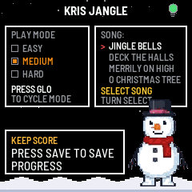

# Kris Jangle

A Christmas phrase game for the M-VAVE FM-1, by w33tSnx.

The FM-1 plays the start of a public-domain carol and you replay it on
the 27 keys. The song builds as you level up — level 1 asks for the
first 3 notes, each level adds 3 more, and level 11 is the whole
32-note song. Accurate notes earn 100 points each, a clean level adds
250, and three misses sends you to Grump Mode, where the Grump jeers
at you before you retry. Finish the whole song and Santa offers the
next one.

Four carols, all transcribed from MIDI in the repo:

- **Jingle Bells** (E–G–C–D–E, low octave)
- **Deck the Halls** (F, from `deck-the-halls.mid`)
- **Ding Dong Merrily on High** (G, from `ding-dong-merrily-on-high.mid`)
- **O Christmas Tree** (F, from `o-christmas-tree.mid`)

## Try it

- **Browser emulator** (plays with mouse, touch, or keyboard, with sound):
  <https://doohinkus.github.io/kris-jangle/emu/>
- **Install** it from Chrome or Edge with the FM-1 connected by USB:
  <https://doohinkus.github.io/kris-jangle/install/>
- **Manual**: <https://doohinkus.github.io/kris-jangle/manual/>

## How to play

On the HOME screen turn **SELECT** to set `SONG:` in the SONG box
(Jingle Bells by default), then press **PLAY**. **LISTEN** plays the
level's notes in a boxed grid; **YOUR TURN** asks you to replay them
from memory or by ear, with Note/Score/Combo/Misses in a boxed grid.
Key BLINK in EASY/MEDIUM guides the first note; HARD shows nothing.
Holding any key shows a large note modal with its name and MIDI
number — on YOUR TURN, green means correct and red means a miss.

Keys play the selected sound (PIANO by default, switchable with
EDIT); MASTER is volume. SAVE keeps your best scores, mode,
and sound. HOME returns to the title; SEQ plays Santa's
intro there.

## Source

Game in `kris-jangle/`:

| File | What |
| --- | --- |
| `app.h` | Name, store objects, backup magic, and the app's half of the platform contract |
| `app.c` | The game: carol data, melody/sound engine (piano/flute/sax samples, bells/choir/kazoo synths), screens, saving |
| `fm1.toml` | Build and site settings |
| `words.tsv` | Screen-reader words |
| `tests/` | Host simulator checks and the manual's screenshots |
| `docs/MANUAL.md` | The full manual |
| `site/landing.md` | The site's front page |

    git clone --recursive https://github.com/doohinkus/kris-jangle

MPL-2.0. Carol melodies are traditional and in the public domain. The
piano, flute and sax samples are CC0 1.0, from Sam Gossner's VCSL and
VSCO-2 CE (Versilian Studios). M-VAVE and FM-1 are trademarks of
their owners; Kris Jangle is not affiliated with M-VAVE.
