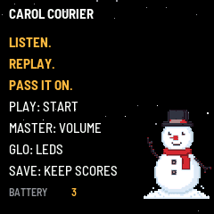

# CAROL COURIER

Carol Courier is a Christmas phrase game for the M-VAVE FM-1. It plays a
4-note phrase of a public-domain carol and you replay it on the 27 keys.
Accurate notes earn 100 points each, a clean phrase adds 250, and three
misses in one phrase sends you to Grump Mode — a kazoo interlude — before
you retry the same phrase. A clean phrase gives you a word-pair Carol Code
you can pass to a friend so they face the same challenge.

## Contents

1. Install
2. The screen
3. Controls
4. Carol Codes
5. Saving
6. The screen reader
7. Troubleshooting

---

## 1. Install

To try it first, open the emulator. It runs the same code in your browser,
with sound, and you can play it with a mouse, a touch screen or your computer
keyboard.

To install it from the browser, use Chrome or Edge. Connect the FM-1 by USB,
open the installer and press Install. The browser asks once to allow MIDI, so
allow it. Don't unplug the cable while it writes. Back up first: firmwares
share the settings sectors, and installing overwrites them.

To go back to the stock firmware, use the installer's last section, which
writes M-VAVE's own firmware back. If the FM-1 doesn't start, it starts in
SAFE MODE after two failed starts, and the web installer can reach it there.

---

## 2. The screen

| Screen | What it shows |
| --- | --- |
| Title | The name, battery level (0–3 bars), and the controls that matter. |
| Carol select | The carol (turn PRESET to change), your best score on it, and your current Carol Code. |
| Code entry | The two code words, one at a time. Turn PRESET to change the word, SELECT for the next word or to go. |
| Listen | The carol's name and which note of 4 is playing. On tiers 1–2 the key lights as each note sounds. |
| Your turn | Notes played so far, score, misses (3 = Grump Mode) and combo. |
| Grump Mode | The kazoo plays the phrase, then you retry it. |
| Result | Score, level, and your Carol Code to pass on. |

---

## 3. Controls

| Control | What it does |
| --- | --- |
| Keys | Play the phrase. The instrument follows the level: music box (level 1), sleigh bells (2), choir-ish stack (3), then it cycles as levels rise. |
| PLAY | Start from the title or select screen, skip Listen, replay a phrase, or go to the next level from the result screen. |
| PRESET | Choose the carol on the select screen; choose a code word on the code screen. |
| SELECT | On the code screen: next word, then start the challenge the code describes. |
| ARP | On the select screen: open code entry. |
| GLO | Key LEDs on or off. |
| MASTER | Volume. This is the only volume control — sound is always on. |
| FX, SEQ, ENV, LFO, EDIT, OCT−, OCT+ | Unassigned in this game; they do nothing. |
| SAVE | Save your best scores, codes and settings. SAVE lights while there's something to save. |
| HOME | Back to the title screen. |

Replay windows: 900 ms per note on tiers 1–2, 600 ms on tier 3. Tier 3 also
hides the LED walkthrough.

---

## 4. Carol Codes

A Carol Code is two words, like `SLEIGH-TREETOP`. The first word picks the
carol and phrase, the second picks the starting level. To use a friend's
code: on the select screen press ARP, turn PRESET to each word, press SELECT
to confirm the first word, then SELECT again to start.

---

## 5. Saving

Press SAVE to keep your best score and level for each carol, your last code,
and the sound/LED settings. They come back the next time the FM-1 starts.
Note: on FM-1s with the newer flash chip, some firmwares can't persist
saves — if yours vanish after a power cycle, that's a known platform issue,
not a broken FM-1.

---

## 6. The screen reader

Carol Courier tells a screen reader what's on its screen through the
[FM-1 Screen Reader](https://charlesvestal.github.io/fm1-reader/). When the
reader starts listening, it hears the name, and then each change as it
happens — including code words, so codes can be entered by ear.

---

## 7. Troubleshooting

If you hear no sound, turn MASTER up and check FX isn't set to OFF.

If the installer doesn't find the FM-1, use Chrome or Edge, allow MIDI when
the browser asks, and close any other programs using the FM-1's MIDI port.

If you keep landing in Grump Mode, slow down: the window is generous on
tiers 1–2, and the LED walkthrough shows the notes. Grump Mode is an
interlude, not a game over — you always retry the same phrase.
