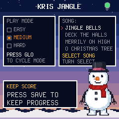
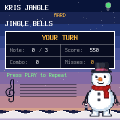
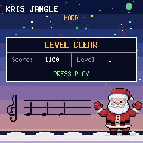

# KRIS JANGLE

Kris Jangle is a Christmas song game for the M-VAVE FM-1. It plays the
start of a public-domain carol (choose SONG: on the HOME screen) and you replay it on the 27 keys, on piano
(or the sound selected with EDIT) throughout. The song builds as you level up: level 1 asks for
the first 3 notes, and each level adds 3 more on top of all the notes
before, so level 11 is the whole 32-note song. Accurate notes earn 100
points each, a clean level adds 250, and three misses sends you to Grump
Mode — a recorded jeer from the Grump — before you retry the level. Finish
the whole song and you get a celebration screen offering the next song. On the title screen, Santa's recorded voice is just a
button away: press SEQ to hear his introduction (any other key or button
stops it).

## Contents

1. Install
2. The screen
3. Controls
4. Saving
5. The screen reader
6. Troubleshooting

---

## 1. Install

To try it first, open the emulator. It runs the same code in your browser,
with sound, and you can play it with a mouse, a touch screen or your computer
keyboard.

To install it from the browser, use Chrome or Edge. Connect the FM-1 by USB,
open the installer and press Install. The browser asks once to allow MIDI, so
allow it. Don't unplug the cable while it writes. Back up first: firmwares
share the settings sectors, and installing overwrites them.

To go back to the stock firmware, use the installer's last section, which
writes M-VAVE's own firmware back. If the FM-1 doesn't start, it starts in
SAFE MODE after two failed starts, and the web installer can reach it there.

---

## 2. The screen

The game plays in a winter dusk: a deep blue sky fading to a warm peach at
the horizon, the first stars out in the dark, firs of different sizes on the
ridge and the snow below. The boot splash shows the frosted name over it:

| Screen | What it shows |
| --- | --- |
| Title (HOME) | The name, a battery lightbulb by the title (red when low, orange at medium, green when full), a PLAY MODE box showing EASY, MEDIUM, HARD with the picked one checked (GLO cycles it), a SONG box listing all four carols with a red arrow on the picked one (turn SELECT to change — Jingle Bells by default), and a KEEP SCORE box. |
| Listen | A boxed grid: `LISTEN...` in the header, then `Note: {note} / {total}` and `Press PLAY to skip`, with a divider between them. Frosty stands on top of the box. In EASY and MEDIUM, the key blinks as each note sounds. |
| Your turn | A boxed grid: `YOUR TURN` in the header, then `Note: {played} / {total}`, `Score: {score}`, `Combo: {combo}` and `Misses: {misses}` (3 = Grump Mode) in two columns, and a blinking `Press PLAY to Repeat` below the box — PLAY replays the level. In EASY, the key to press stays lit the whole turn. |
| Grump Mode | The Grump jeers (recorded clip), then you retry it. |
| Result | A boxed grid: `LEVEL CLEAR` in the header, then `Score: {score}` and `Level: {level}` in two columns, and a blinking `PRESS PLAY` in a spanning bottom row — PLAY goes to the next level. |
| Song complete | The whole song played: score, Santa and the confetti. The badge follows on its own — the trophy for the song, the QR code of the carol and the whole song (level 11). PLAY on the badge goes to the next song. |
| Badge | A QR code on paper, with the carol and the level it is a badge for, `SCAN FOR YOUR BADGE` and `PLAY: BACK`. LFO opens it (on the title, the song's best level; after a level, the level just cleared; after a whole song, the song itself). Scan it with a phone's camera and the page on the phone shows the badge on the ice card — the carol's name, the level, the levels cleared, Frosty and the Grump he was saved from, a green `SAVED` seal, and `Congratulations, you saved Jingle Bells from the Grump. Save more carols to spread holiday cheer.` You can share it as an image. The page is the reference's own world (the indigo-to-rose sky, its snowflake stars, the ice card with its green seal) and is laid out for a phone held either way up: held sideways, the badge and the message stand side by side and the page does not scroll. It works offline after the first load; a badge from a scanned code is a challenge, not a verified trophy (that comes with the sound link). |
| The staff | On the LISTEN, YOUR TURN and LEVEL CLEAR screens (not the title, the sound page or Grump Mode), a treble clef and five lines write the notes as they are played, on the sky under the boxes: there is no panel behind them, the staff is written in black ink on the dusk, and the firs on the ridge step aside so the ink is not lost in the trees. The demo's notes land on the staff as they sound, yours line up as you press. They carry the tune's own values — a quarter, a half, a dotted quarter — with the head a leaning oval, filled or hollow, the stem on the head's far side, the flag of an eighth, the dot of a dotted note, and a bar line every four beats. The staff is a bar of 4/4 that scrolls: what is written stays until a bar has passed, and the oldest notes leave at the left. A black key's head comes with a sharp sign; a note below the staff (F3 and under) draws its ledger lines. The notes are in ink, a miss in deep crimson (a bright red would not read on the pink sky). Off by default — turned on with SELECT on the sound page (below). |
| Held keys | While any key is physically held (sound pages and YOUR TURN; not on the title/HOME screen), a large note modal covers the screen showing every held note as `C4 60` (name + octave above, MIDI number below); it disappears on release. On YOUR TURN each note carries a dot: green if it was correct when pressed, red if it was a miss. With the staff on, the modal stays hidden: the staff writes the notes instead, so the two never share the screen. |

With the staff on, it draws under the boxes on the game screens:

---

## 3. Controls

| Control | What it does |
| --- | --- |
| Keys | Play the level's notes, in the selected sound (PIANO is the default: a sampled grand piano pitch‑shifted over the 27 keys). Holding a key shows a large note modal naming the note and its MIDI number, except on the title/HOME screen (see Held keys, above). Each key also sends its note, with velocity, as MIDI out over USB and Bluetooth (channel 1) while MIDI is on. The Listen playback is not sent — only what you play. On Bluetooth, choose the FM-1 in your app's MIDI input list (it appears as the device name). |
| PLAY | Start from the title screen (at the selected `SONG:`), skip Listen, replay a level, go to the next level from the result screen, or start the next song from the song-complete screen. |
| PRESET | Unassigned in this game; it does nothing. |
| SELECT | On the HOME screen: cycle the song (`SONG:` — Jingle Bells, Deck the Halls, Merrily on High, O Christmas Tree). Defaults to Jingle Bells; the choice applies to the next game and is session-only. On the SELECT SOUND page (EDIT): turn SELECT to switch the grown-ups' staff on or off; the page shows `SELECT: STAFF` with its state. The staff choice is kept with SAVE. |
| ARP, OCT−, OCT+, ENV | Unassigned in this game; they do nothing. |
| LFO | Show the badge: a QR code on the screen that opens the badge page on a phone (the carol and the level are in the address). On the HOME screen it is the song's best level, after a level the level just cleared. PLAY goes back. After a whole song the badge comes on its own: it is the trophy for the song. |
| GLO | Cycle the play mode: EASY, MEDIUM, HARD. The mode is shown at the top of every screen. |
| FX | Turn MIDI out on or off, on both USB and Bluetooth. The screen reader says MIDI ON or MIDI OFF. The choice is kept with SAVE. |
| EDIT | Open SELECT SOUND: turn PRESET to change the sound (BELLS, CHOIR, KAZOO, PIANO, FLUTE, SAX), play keys to audition, PLAY to finish. Kept with SAVE. |
| MASTER | Volume. This is the only volume control — sound is always on. |
| SEQ | On the title screen only: play Santa's intro voice. |
| OCT−, OCT+ | Unassigned in this game; they do nothing. |
| SAVE | Save your best scores and settings. SAVE lights while there's something to save. |
| HOME | Back to the title screen. |

Play modes (GLO cycles them; the mode is saved with SAVE — and the title
screen names each control):

| Mode | Listen | Your turn |
| --- | --- | --- |
| EASY | The sounding note's key blinks. | The key to press next stays dimly lit, so you can see what to play while you play it. |
| MEDIUM | The sounding note's key blinks. | No key is shown; you play from memory of the Listen phase. |
| HARD | No key is shown; you play from the sound alone. | No key is shown; sound alone. |

In every mode the key you physically press still lights, and the unlit
buttons still glow. Grump Mode's replay follows the same rules as Listen.

---

## 4. Saving

Press SAVE to keep your best score and level for each carol, the play mode,
the MIDI on/off choice, the selected sound, and the grown-ups' staff on/off.
They come back the next time the FM-1 starts.
The backup files moved with the staff: a `.ccb` made before this change
(version 3) is refused on restore. Make a new backup on the old firmware
before you update, if you want to keep one.
Note: on FM-1s with the newer flash chip, some firmwares can't persist
saves — if yours vanish after a power cycle, that's a known platform issue,
not a broken FM-1.

---

## 5. The screen reader

Kris Jangle tells a screen reader what's on its screen through the
[FM-1 Screen Reader](https://charlesvestal.github.io/fm1-reader/). When the
reader starts listening, it hears the name, and then each change as it
happens. Turning the staff on or off is announced (`STAFF ON` / `STAFF OFF`),
and so is the sound and the play mode.

---

## 6. Troubleshooting

If you hear no sound, turn MASTER up. Sound is always on — there is no mute.

If the installer doesn't find the FM-1, use Chrome or Edge, allow MIDI when
the browser asks, and close any other programs using the FM-1's MIDI port.

If you keep landing in Grump Mode, slow down: the window is generous, and
in EASY the key to press stays lit (in MEDIUM it blinks during Listen, and
HARD shows no guidance). Grump Mode is an
interlude, not a game over — you always retry the same level.
